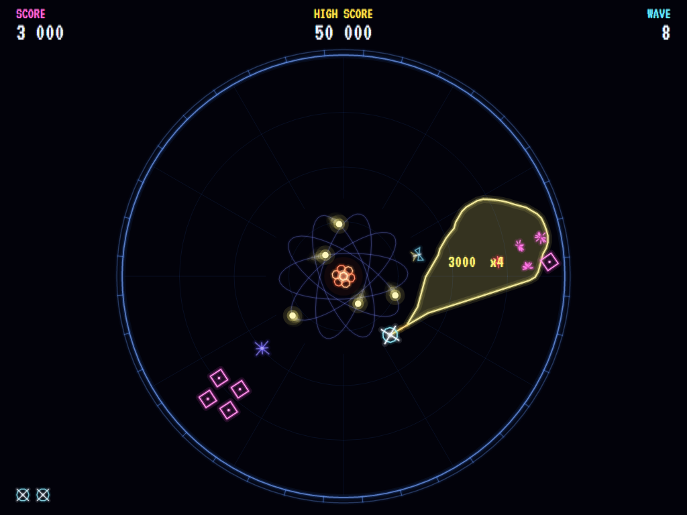
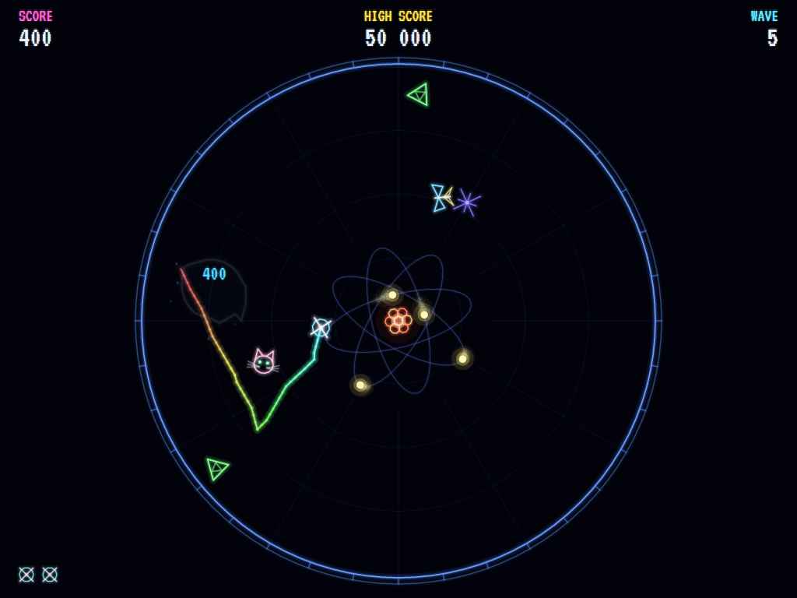
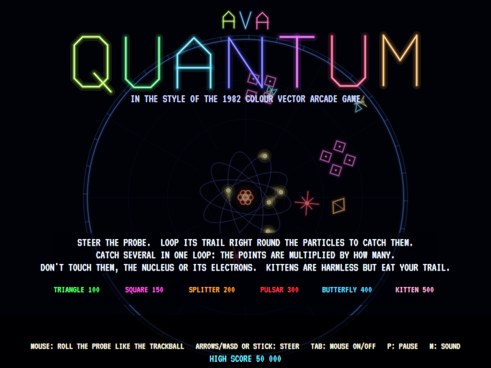
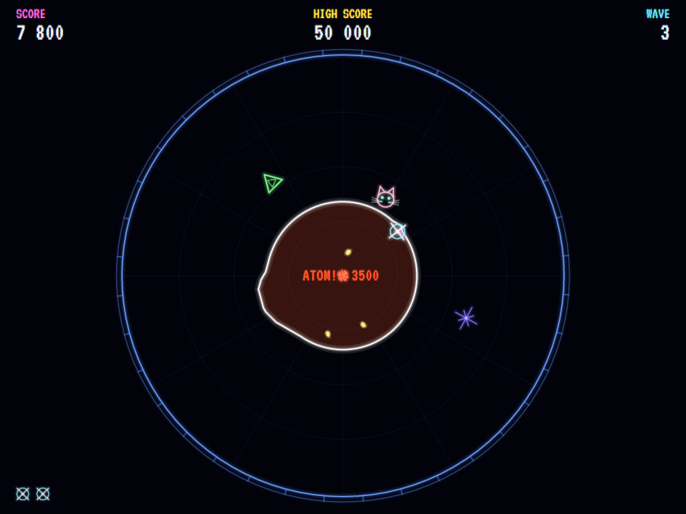

# AVA Quantum

[](https://github.com/Harlock123/AVAQuantum/actions/workflows/build.yml)

A colour vector arcade game in the style of Atari and General Computer's 1982 arcade game **Quantum**, built with
.NET 10 and Avalonia UI. You steer a probe round the inside of an atom, leaving a short glowing trail behind it.
Nothing is shot: you catch particles by running your trail right round them and crossing it to close the loop.
Catch several in one loop and the points multiply. Touch one, or the nucleus, or the electrons racing round it,
and the probe is lost.

## Features

- **Catching by looping:** the probe leaves a rainbow trail, only so long, that fades as it goes. Cross your own
  trail and the loop it closes flashes: everything inside it is caught. A tiny wiggle catches nothing, and a loop
  round nothing is just a blip.
- **Multipliers:** each particle is worth its points times how many went in the same loop. Three in one loop is
  three times the points for each.
- **The atom:** a throbbing nucleus in the middle with its electrons racing round tilted orbits, like the drawing
  of an atom. Touch any of it and the probe goes. Particles come out of the nucleus at the start of each wave, and
  bounce off the orbits after that. Loop the *whole atom* and it breaks for a big bonus (once a wave), then forms
  again a few seconds later.
- **Six kinds of particle,** each with its own way of moving and its own points:
  - **Triangles** (100) drift in straight lines and bounce off the wall.
  - **Foursquares** (150 a square) are four squares wheeling round each other as they go; catch all four in one
    loop for a 2 000 bonus.
  - **Splitters** (200, 150, 100) fly apart in two when caught, and the halves split again; the quarters go for
    good.
  - **Pulsars** (300) charge up and go dark in turn: dark they're harmless, but charged they blaze, they're deadly,
    and they come after the probe.
  - **Butterflies** (400) flutter fast and at random.
  - **Kittens** (500) can't hurt the probe, but they go for the trail and eat it, loop and all.
- **Waves that get harder:** the first eight bring in one new kind of particle at a time, with a hint; after that
  each wave is a growing random mix. Everything gets quicker, more electrons orbit faster, pulsars charge sooner,
  and the trail gets shorter.
- **The colour vector look:** every line drawn as the beam draws it, a bright core in a soft bloom, on black;
  sparks when anything goes; the title in vector letters.
- **Mouse as the trackball:** the original was played with a trackball, and here the mouse is the ball: the probe
  races to wherever you roll it. The arrows, WASD or a gamepad's stick spin it up and let it run down.
- **Sound:** chirps, zaps, the atom's boom and a kitten's mew, all synthesised, and a title tune.
- **Lives and points:** three probes, an extra one at 20 000 and every 30 000 after; a bonus for each wave
  cleared.
- **The attract mode** shows the computer player at work: it picks a particle with room to loop round it, runs
  rings round it, and keeps clear of the electrons and anything charged, where they'll be in the next moments.

## Screenshots

| A catch | Looping | The title |
|:-------:|:-------:|:---------:|
|  |  |  |
| Four at once, times four. | A rainbow trail, and a kitten after it. | The atom behind the title. |

| Breaking the atom |
|:-----------------:|
|  |
| Loop the whole atom for the bonus. |

The screenshots are made by the tests, which play the game in a real (headless) window; see
[Tests](#tests).

## Download and run

Ready-to-run builds for Windows, macOS and Linux, on both Intel/AMD and ARM, are on the
[Releases page](https://github.com/Harlock123/AVAQuantum/releases/tag/latest). **Latest build** is
rebuilt on every push to `main`. Each download is one self-contained executable: no .NET install is
needed.

| Platform | Archive |
|---|---|
| Windows | `AVAQuantum-win-x64.zip`, `AVAQuantum-win-x86.zip`, `AVAQuantum-win-arm64.zip` |
| macOS | `AVAQuantum-osx-arm64.tar.gz` (Apple silicon), `AVAQuantum-osx-x64.tar.gz` (Intel) |
| Linux | `AVAQuantum-linux-x64.tar.gz`, `AVAQuantum-linux-arm64.tar.gz`, `AVAQuantum-linux-arm.tar.gz` |

```bash
tar -xzf AVAQuantum-linux-x64.tar.gz     # or linux-arm64, linux-arm, osx-arm64, osx-x64
./AVAQuantum
```

On Windows, unzip and run `AVAQuantum.exe`. On macOS, if Gatekeeper refuses to open it, run
`xattr -d com.apple.quarantine AVAQuantum` once. Run with `--no-audio` for silence.

**Sound** comes through OpenAL Soft, built in for every platform. In a virtual machine the game
detects it and uses a larger audio buffer, so the sound doesn't break up.

**Gamepads** use SDL2, which is bundled for Windows, macOS and Intel/AMD Linux. ARM Linux builds need it
installed; without it the keyboard and mouse still work:

```bash
sudo apt install libsdl2-dev            # Debian / Ubuntu / Raspberry Pi OS
sudo pacman -S --needed sdl2-compat     # Arch / Omarchy
```

## Controls

| Action | Keyboard | Mouse | Gamepad |
|---|---|---|---|
| Start | Enter, 1 or Space | Click | Start or A |
| Steer the probe | Arrows, WASD or the keypad | Roll it (the probe follows) | Left stick / D-pad |
| Mouse control on/off | Tab | | |
| Pause | P or Esc | | Start or Back |
| Sound on/off | M | | |
| Screenshot | Ctrl+S (to your Pictures folder) | | |

The mouse is on from the start; holding a key or the stick takes over from it until the mouse is moved again.
On the keys or the stick the probe picks up speed and runs on a little when let go, like a spun trackball. On
the high-score table, type your initials, or use up/down and Space, then Enter.

## Tests

```bash
dotnet test AVAQuantum.slnx
```

The game runs in fixed 60 Hz steps, so it plays the same at any frame rate. The tests check:

- **Catching:** running the trail round a particle and across itself catches it and clears the trail; a loop
  round nothing catches nothing; a line that never crosses itself catches nothing, and nor does a tiny wiggle;
  three in one loop score three times each; each kind's points; a whole foursquare earns its bonus, part of one
  doesn't and the rest carry on wheeling round their middle; a splitter splits in two, harmless for a moment,
  then again, then goes.
- **What's deadly:** touching a triangle, square, splitter or butterfly destroys the probe; a kitten doesn't; a
  pulsar only while charged, when it comes after the probe; the electrons (which stay on their orbits) and the
  nucleus; nothing while the probe is just back; a kitten eats the trail.
- **The atom:** looping the whole atom breaks it for a bonus, it can't hurt while broken, it forms again, and the
  bonus comes once a wave; particles keep out of the orbits and inside the wall; they come out of the nucleus
  harmless and uncatchable until they're clear.
- **The probe:** it races to a point and never leaves the arena; on the keys it picks up speed and runs down;
  the trail is only so long and fades with time.
- **The game:** a cleared wave pays its bonus and brings the next; the waves get harder in every way and every
  kind of particle turns up; a hit costs a life and the probe comes back untouchable; the last life ends the
  game and a good score gets initials, kept between games; extra lives; pause; the title, the demonstration and
  the high scores take turns; every sound has its file. The computer player clears waves, scores and survives,
  and plays the demonstration.
- **The controls,** through the input handler: up moves the probe up the screen and down down it, left and right
  across, two keys diagonally and no faster; the mouse sends it to the pointer and the keys take over until the
  mouse moves again; looping with the mouse or with the keys catches a particle; Enter and Space start; a Shift
  let go as Caps Lock is let go.

`tests/AVAQuantum.Tests/PilotProbe.cs` reports how the computer player gets on over whole games, for tuning
(`QUANTUM_PROBE=1`, or a wave number to start there; `QUANTUM_SEEDS=1,2,3`).

The screenshot tests draw the real screen in a headless window. To refresh the README's pictures:

```bash
QUANTUM_SHOTS=$PWD/Images dotnet test tests/AVAQuantum.Tests --filter ScreenshotTests
```

## Building

```bash
dotnet build AVAQuantum.slnx
dotnet run --project src/AVAQuantum
```

Needs the .NET 10 SDK. The sounds and the title tune are made by `tools/make_sounds.py` (standard-library
Python): `python3 tools/make_sounds.py` rewrites `src/AVAQuantum/Sounds`.

## Project structure

```
AVAQuantum/
├── AVAQuantum.slnx
├── src/AVAQuantum/
│   ├── Engine/
│   │   ├── GameEngine.cs        # States, the wave callouts, losing a life, clearing a wave
│   │   ├── World.cs             # The probe, its trail and the loop, the particles, the atom
│   │   ├── Geometry.cs          # Where lines cross, a loop's area, what's inside it
│   │   ├── Entities.cs          # The particles, the probe, sparks and the palette
│   │   ├── WaveBook.cs          # What each wave holds and how hard it is
│   │   ├── Field.cs             # The screen's and the arena's measures, the controls
│   │   ├── Pilot.cs             # The computer player (the demonstration, and the tests)
│   │   ├── HighScoreTable.cs, InitialsEntry.cs
│   │   ├── InputHandler.cs, ControllerManager.cs  # Keys, the mouse and an SDL2 gamepad
│   │   └── SoundManager.cs      # Effects and the title tune through OpenAL
│   ├── Audio/                   # The OpenAL engine (from the author's AVABand)
│   ├── Views/                   # The drawing: glowing vector lines on black
│   └── Sounds/                  # The synthesised effects and tune
├── tests/AVAQuantum.Tests/      # Gameplay, input and screenshot tests
├── tools/make_sounds.py
└── Images/                      # Screenshots
```

## About and licence

AVA Quantum © 2026 Lonnie Watson, under the [MIT License](LICENSE).

*Quantum* © 1982 Atari, Inc., designed by General Computer Corporation; the name belongs to its current owner.
AVA Quantum is an independent, unofficial game in its style. Its particles, graphics, sounds, music and code are
its own; nothing is taken from the original game's program, graphics or sound. It is not affiliated with or
endorsed by any rights holder.

The text is set in [VT323](https://fonts.google.com/specimen/VT323) by Peter Hull, under the SIL Open Font
License (`src/AVAQuantum/Assets/Fonts/VT323-OFL.txt`). Sound is played through
[OpenAL Soft](https://openal-soft.org/) (LGPL; see `src/AVAQuantum/Audio/native/COPYING-openal-soft.txt`) by way
of Silk.NET, and gamepads are read through SDL2.
